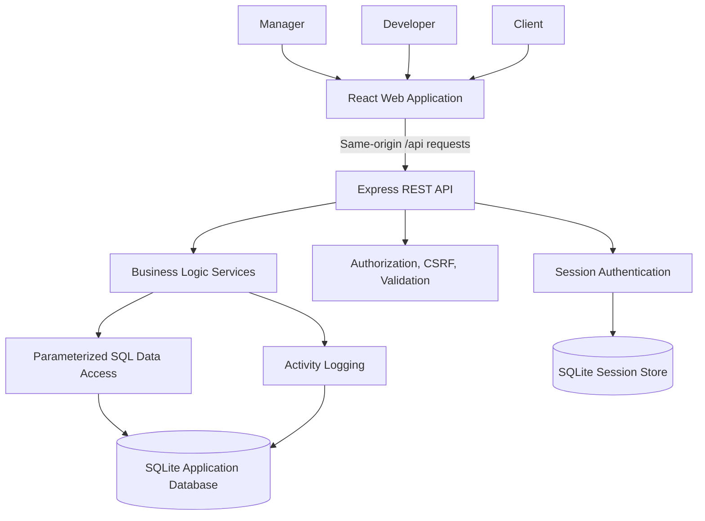
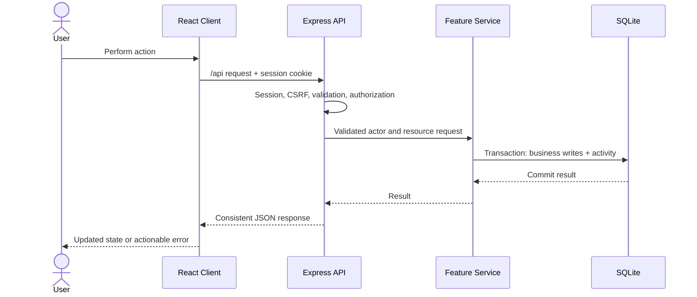

# AgencyDesk Architecture

## Scope and deployment

AgencyDesk is a modular monolith for one agency, deployed as one application. The React/Vite browser client and Express REST API are separate applications in the repository, but the initial production arrangement serves them from the same origin. Vite proxies `/api` to Express during development. SQLite stores application records; a separate SQLite file stores persistent Express sessions.

This is a deliberately small, educational deployment design. It does not claim high availability, horizontal scaling, or production readiness. See [DECISIONS.md](DECISIONS.md) for the rationale and revisit conditions for major technology choices.

## System context

## Backend responsibilities

- **Routes** map HTTP methods and paths to middleware and controllers. All API paths use `/api`.
- **Middleware** parses requests, loads the session identity, applies CSRF and Origin checks to state-changing requests, validates input, and handles errors.
- **Authorization** uses the authenticated user plus database-derived project, milestone, deliverable, or organization relationships. A role or resource owner supplied in the request body is never trusted.
- **Controllers** translate HTTP input to service calls and return the shared JSON response shape. They do not own long SQL queries or workflow rules.
- **Services** enforce allowed transitions and role/resource rules. A multi-write operation, including its activity event, uses one database transaction.
- **Database access** contains focused, parameterized SQLite queries. Foreign-key enforcement is enabled on every application database connection.
- **Activity logging** appends the authenticated actor, related project/entity, action, safe metadata, and UTC timestamp to the application database. The public API has no update/delete operation for activity entries.

## Request lifecycle

1. A React page calls the shared HTTP client for `/api/...`; state-changing requests include the session's CSRF token.
2. Express parses the request and identifies the server-side session. Login regenerates the session identifier; logout destroys the server-side session.
3. Middleware checks Origin and CSRF for mutations, validates the request shape, and establishes the authenticated user.
4. The authorization/service path loads the target resource and its actual owning project/client, then applies the policy in [PRD.md](PRD.md).
5. A service applies the documented workflow transition and performs related writes plus activity logging transactionally.
6. The controller returns a consistent JSON response. Expected errors have stable codes; production responses do not disclose SQL, stack traces, or secrets.
7. React updates its local view or presents a useful loading, empty, success, or error state.

Authentication initialization and public login are exceptions to the normal authenticated-request sequence. Their routes receive only the middleware appropriate to their behavior; the login route is rate-limited.

## Authentication and browser security

- Authentication uses server-side `express-session` records in a small SQLite-backed store built on the existing Promise SQLite data driver, not browser-stored JWTs. This avoids an outdated session-store wrapper dependency tree while preserving persistent session storage.
- Session cookies are `HttpOnly`, use a non-default name, have a configured lifetime, and use `Secure` under HTTPS production deployment. `SameSite=Lax` is the baseline.
- A cryptographically random synchronizer token is associated with the session and required in `X-CSRF-Token` for state-changing requests. Origin validation is defense in depth. Token/session rotation behavior is specified before implementation and tested in Phase 3.
- Passwords are stored as hashes only. Temporary credentials require a password change. API profile responses never include hashes or session identifiers.
- Helmet and login rate limiting are applied. Server-side authorization remains authoritative even if a UI route or action is hidden.
- State-changing input is validated and persisted using bound SQL values and explicit field allowlists.

## Data ownership and authorization boundary

The system has one agency and multiple client organizations. A manager can access agency records. A developer can access only projects with a `project_members` assignment. A client user belongs to exactly one `clients` row and can access projects belonging to that organization. Project ownership must be resolved from the database for every nested-resource operation; IDs supplied by the browser do not establish ownership. These rules and the complete action matrix are in [PRD.md](PRD.md).

## Data stores and transaction boundary

The application database contains users, clients, projects, assignments, milestones, deliverables, submission/review history, comments, change requests, and activity. The session database contains only server-managed session records. Each stays in a configurable local SQLite file during development; both paths are excluded from version control.

For a business operation that must leave an audit event, the state update and activity insert commit or roll back together. The detailed relational sketch, constraints, and deletion policy are in [DATA_MODEL.md](DATA_MODEL.md).

## Local and production request paths

## Architectural limitations

- A single SQLite application database and one application instance are the scope. Multiple server instances would require a shared session store and a separately evaluated relational database/deployment plan.
- Same-origin hosting is assumed. A separate frontend origin would require deliberate CORS, cookie, CSRF, and deployment configuration.
- Deliverables are links; file uploads, external service integrations, email, real-time communication, and multi-agency tenancy are out of scope.
- Automated tests can provide evidence for selected behaviors but do not establish a security guarantee.