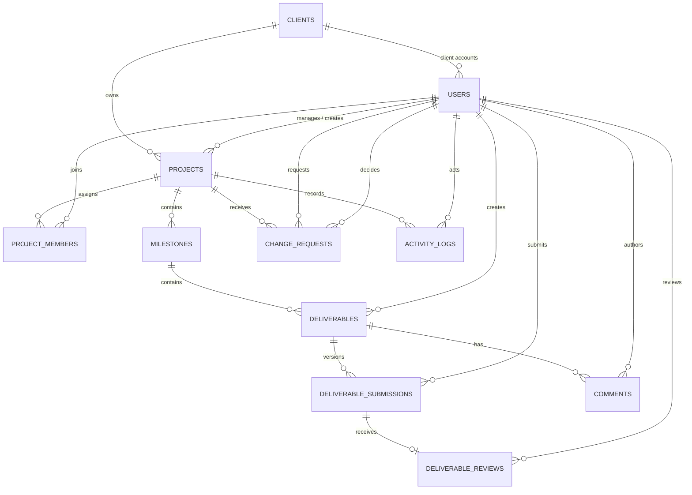

# AgencyDesk Data Model

## Modeling conventions

- Every entity uses an integer primary key; `project_members` uses a composite primary key.
- Timestamps are UTC ISO 8601 text values with an explicit `Z` suffix, generated by the application. Date-only values use ISO `YYYY-MM-DD` text.
- SQLite foreign-key enforcement is enabled for every application database connection.
- Migrations are numbered and append-only. Schema evolution is not performed by overwriting an earlier migration.
- Foreign keys use restrictive deletion for business/audit records. Referenced clients and users are deactivated, not physically deleted. The development seed command is explicit and must document any reset behavior.
- The session store is a separate SQLite database and contains no business records. Its `sessions` table stores a session ID, serialized Express session data, and an expiration timestamp; session IDs and serialized session content are never returned by the API.

## Entity relationship diagram

`activity_logs.entity_type/entity_id` is a polymorphic reference and intentionally has no foreign key to every possible entity table. `project_id` and `actor_user_id` are real foreign keys when present. Activity detail must not contain credentials, session IDs, CSRF tokens, or other secrets.

## Tables and invariants

### `clients`

Fields: `id`, `name`, optional `contact_email` and `description`, `is_active`, `created_at`, `updated_at`.

Organization records are deactivated rather than deleted. A client can own multiple projects and have multiple client users.

### `users`

Fields: `id`, `full_name`, `email`, `password_hash`, `role`, nullable `client_id`, `is_active`, `must_change_password`, `created_at`, `updated_at`.

- `role` is constrained to `manager`, `developer`, or `client`.
- Email is unique case-insensitively.
- A client user has exactly one `client_id`; manager/developer users have `client_id IS NULL`. Enforce this with a table `CHECK` constraint.
- Never expose `password_hash` through the API. Deactivate referenced users rather than deleting them.

### `projects`

Fields: `id`, `client_id`, `name`, `description`, `status`, `start_date`, `due_date`, `project_manager_id`, `created_by`, `created_at`, `updated_at`.

- `client_id`, `project_manager_id`, and `created_by` reference `clients`/`users` with restrictive deletion.
- `status` is `planning`, `in_progress`, `on_hold`, `completed`, or `cancelled`.
- A date check enforces `start_date <= due_date` when both are present.
- The service validates that `project_manager_id` is an active manager and `created_by` is an authorized manager. The manager's assignment is for accountability; manager access is agency-wide and does not depend on that assignment.
- A project can be marked completed manually only when all its milestones are completed. A project with no milestones may be completed manually. No milestone completion automatically changes project status.
- Completed and cancelled projects accept no new delivery work, comments, or change requests; authorized users may continue reading history.

### `project_members`

Fields: `project_id`, `user_id`, `assigned_at`, `assigned_by`.

- Composite primary key (or equivalent unique constraint) on `(project_id, user_id)`.
- `user_id` must be an active developer; the service enforces role and activity because the role belongs to another table.
- `assigned_by` references the manager who assigned the developer.
- A developer's project access requires a matching assignment row.

### `milestones`

Fields: `id`, `project_id`, `title`, `description`, `position`, `start_date`, `due_date`, `status`, `created_at`, `updated_at`.

- `project_id` references `projects`; `(project_id, position)` is unique for stable ordering.
- `status` is `not_started`, `in_progress`, `blocked`, or `completed`.
- A date check enforces `start_date <= due_date` when both exist.
- Every deliverable in a milestone is required for completion in this MVP; there is no optional-deliverable flag.
- The service rejects completion until every deliverable in the milestone is approved. A manager may complete a milestone that has no deliverables.

### `deliverables`

Fields: `id`, `milestone_id`, `title`, `description`, `status`, `created_by`, `created_at`, `updated_at`.

- `milestone_id` and `created_by` reference their parent/actor.
- `status` is `draft`, `submitted`, `revision_requested`, or `approved` and reflects the current workflow state, updated transactionally with submission/review records.
- Managers may create or submit on agency projects. Developers may create or submit only on assigned projects. Clients cannot create or submit.

### `deliverable_submissions`

Fields: `id`, `deliverable_id`, `version_number`, `url`, `notes`, `submitted_by`, `submitted_at`.

- Unique `(deliverable_id, version_number)`; version numbers start at 1 and increase by one.
- Every initial submission and resubmission inserts a new row; earlier versions are never overwritten.
- The URL is parsed and accepted only for `http:` or `https:` schemes. The internal record key is separate from the user-supplied URL.
- An initial submission is permitted from `draft`; a resubmission is permitted from `revision_requested`. Only one current submitted version awaits a final review at a time.

### `deliverable_reviews`

Fields: `id`, `submission_id`, `reviewer_id`, `decision`, `feedback`, `reviewed_at`.

- Unique `submission_id` enforces at most one final review per version.
- `decision` is `approved` or `revision_requested`.
- A revision decision requires non-blank feedback. Approval feedback may be absent.
- The service verifies that the reviewer is an active client user belonging to the organization that owns the submission's project. Attribution is derived from the session, never request input.

### `comments`

Fields: `id`, `deliverable_id`, `author_id`, `body`, `created_at`, optional `updated_at` only if editing is later supported.

- Body is non-blank and has a documented maximum length enforced by request validation and, where practical, a database check.
- A comment is append-only in the initial release: no edit/delete endpoint.
- An authorized manager, assigned developer, or owning client user may read and add comments. The server verifies project access through the deliverable's milestone and project.

### `change_requests`

Fields: `id`, `project_id`, `requested_by`, `title`, `description`, `status`, nullable `estimated_extra_days`, `decision_by`, `decision_notes`, `decided_at`, `created_at`, `updated_at`.

- `status` is `submitted`, `under_review`, `approved`, `rejected`, or `withdrawn`.
- `requested_by` must be a client user from the project's owning organization.
- Only a manager can start review or make the final decision. A final decision records `decision_by`, non-blank `decision_notes`, and `decided_at`; undecided/withdrawn states have no decision attribution.
- The requesting client may withdraw while status is `submitted` or `under_review`.
- Approval does not implicitly modify project scope, dates, milestones, or estimates.

### `activity_logs`

Fields: `id`, nullable `actor_user_id` only for documented system action, nullable `project_id`, `entity_type`, `entity_id`, `action`, `metadata_json`, `created_at`.

- Metadata is valid JSON and uses an allowlist of safe event details.
- Activity is append-only through the public application interface.
- Business state and its required activity event are written in one transaction.
- Project activity reads use the same project access rules as the parent project.

## Status transitions

### Projects

`planning -> in_progress | on_hold | cancelled`

`in_progress -> on_hold | completed | cancelled`

`on_hold -> planning | in_progress | cancelled`

`completed` and `cancelled` are terminal. Only managers change project status. `completed` additionally requires every milestone completed; when there are no milestones, a manager may complete manually. Neither terminal state accepts new milestones, deliverables, submissions, comments, or change requests.

### Milestones

`not_started -> in_progress | blocked`

`in_progress -> blocked | completed`

`blocked -> in_progress`

`completed` is terminal. Managers may make the listed transitions. An assigned developer may set `not_started -> in_progress`, `in_progress -> blocked`, or `blocked -> in_progress`, but cannot complete a milestone. Completion requires all deliverables approved; no-deliverable milestones can be completed by a manager.

### Deliverables

`draft -> submitted -> approved`

`draft -> submitted -> revision_requested -> submitted`

Only managers and assigned developers submit. Only an authorized client user reviews the current submission. An approved deliverable is terminal in this release. Resubmission creates a new version, and review applies to the exact version submitted.

### Change requests

`submitted -> under_review -> approved | rejected`

The requesting client can withdraw from `submitted` or `under_review`. Managers alone can move a request into review and decide it. Approved, rejected, and withdrawn are terminal. Every transition and final decision is recorded in activity; final decision details remain on the request.

## Indexes

Add indexes for actual list/join paths: `users(email)` unique case-insensitively, `users(client_id)`, `projects(client_id)`, `projects(project_manager_id)`, `projects(status)`, both `project_members` keys, `milestones(project_id, position)`, `deliverables(milestone_id)`, `deliverable_submissions(deliverable_id, version_number)`, `change_requests(project_id, status)`, and `activity_logs(project_id, created_at)`. Unique constraints may provide some of these indexes; avoid duplicate indexes.

## Enforcement boundary

SQLite enforces primary/foreign keys, unique constraints, non-null fields, fixed status/role values, email uniqueness, dates, and the `users.role`/`client_id` pairing. Services enforce cross-row conditions that ordinary row checks cannot express, including actor role, project-client ownership, developer assignment, current workflow state, and completion conditions. All such service checks must be covered by API/workflow tests. A follow-up trigger is not required for the initial design unless implementation demonstrates a concrete invariant that can be enforced safely and clearly in SQL.