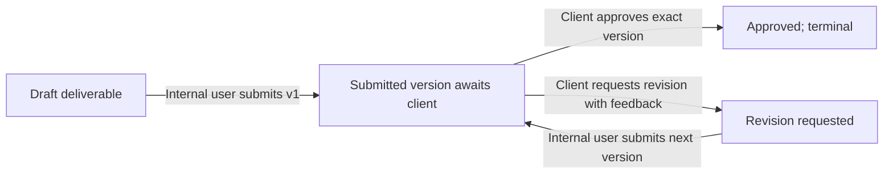
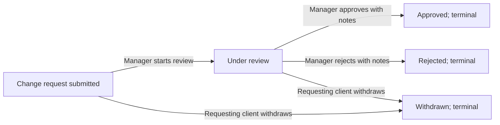

# AgencyDesk Product Requirements

## Product

**AgencyDesk: B2B Client Project Delivery and Approval Management System** is a single-deployment web application for one small web/software agency and its business clients. It centralizes project scope, milestones, linked deliverables, client reviews, change requests, and an attributable activity history.

## Problem and objective

Project decisions and delivery status are often split across email, chat, spreadsheets, and shared documents. That makes it hard to establish what was agreed, what is awaiting review, which revisions remain, and who made a decision. AgencyDesk provides one traceable workflow backed by a relational database and a role-protected REST API.

The first release is an educational, small-agency application. It must persist real data, enforce permissions in the backend, preserve submission and review history, and provide role-scoped project status. It is not a claim of enterprise scale or production readiness.

## Users and permissions

| Capability | Manager | Developer | Client |
| --- | --- | --- | --- |
| View client organizations | All | No | Own organization only |
| Create/edit clients and client accounts | Yes | No | No |
| Create/edit projects and assign developers | Yes | No | No |
| View projects and milestones | All agency projects | Assigned projects | Own organization's projects |
| Create/submit deliverables | Any agency project | Assigned projects | No |
| Update milestone progress | Yes; all allowed transitions | Assigned project; progress transitions only, never completion | No |
| Review a submitted deliverable | No | No | Own organization's project only |
| Read/add deliverable comments | Any agency project | Assigned projects | Own organization's projects |
| Submit/withdraw a change request | No | No | Own organization's project; withdraw own undecided request |
| Start review/decide a change request | Yes | No | No |
| View activity and dashboard | Agency-wide | Assigned projects | Own organization's projects |

Access is denied unless explicitly permitted. Protected endpoints establish resource ownership from database relationships and the authenticated session; browser navigation and caller-supplied role or attribution fields are never authorization controls.

## MVP scope

- Manager, developer, and client accounts with server-side sessions and password hashes.
- Client organizations, client users, projects, project managers, and developer assignments.
- Ordered milestones with validated dates and documented status transitions.
- Deliverables linked to HTTP/HTTPS resources, immutable submission versions, client reviews, comments, and revision cycles.
- Client change requests with manager decisions and retained decision details.
- Append-only application activity records for important business actions.
- Database-backed, role-scoped dashboards and responsive pages for the core workflows.
- SQL migrations, deterministic intentional demo seeding, API and workflow tests, setup instructions, and security limitations.

## Out of scope for the first release

Payments/invoicing, email delivery or automatic invitations, real-time chat, video meetings, file storage/uploads, repository or deployment integrations, AI estimates, subscriptions, multiple agency tenants, microservices, and automated deployment of client sites. Deliverables are external HTTP/HTTPS links.

## Core workflows

### Deliverable review

An authorized internal user (manager on any agency project or developer on an assigned project) creates a draft and submits a valid HTTP/HTTPS link. The initial submission is version 1. Each resubmission after a revision request creates the next numbered version; a second submission cannot be opened while the current version awaits a review. A client user belonging to the project's owning organization reviews that exact current version and either approves it or requests revisions with non-blank feedback. A review is final and applies to only one submission. A draft cannot be reviewed, prior versions/reviews are never overwritten, and an approved deliverable is terminal in this release.

### Change request

A client submits a request for a project in its own organization. A manager moves it from `submitted` to `under_review`, then records an approval or rejection with non-blank decision notes, identity, and time. The requesting client may withdraw its own request while it is `submitted` or `under_review`. Approved, rejected, and withdrawn requests are terminal. An approved request remains in history and does not silently alter project scope, dates, milestones, or estimates.

### Workflow diagrams

### Milestone completion

A manager can update milestone status. An assigned developer may make only these progress transitions: `not_started -> in_progress`, `in_progress -> blocked`, and `blocked -> in_progress`; developers cannot complete milestones. The manager transition rules are `not_started -> in_progress | blocked`, `in_progress -> blocked | completed`, and `blocked -> in_progress`; completed milestones are terminal. Every deliverable in a milestone is required in this MVP; completion is blocked until all are approved. A milestone with no deliverables may be completed manually by a manager. Project status changes are also manager-only: `planning -> in_progress | on_hold | cancelled`, `in_progress -> on_hold | completed | cancelled`, and `on_hold -> planning | in_progress | cancelled`. A project may be manually completed only when all its milestones are completed; a project with no milestones may be completed manually. Completing a milestone never automatically changes project status. Completed and cancelled projects are terminal and accept no new milestones, deliverables, submissions, comments, or change requests; authorized users retain read access to historical records.

### Comments and activity

Managers, assigned developers, and client users from the owning organization may read and add deliverable comments. Comments are non-blank, length-limited, and append-only in the MVP. Each comment and activity event records its real session actor. Managers can read project activity agency-wide; developers and clients see only activity for projects they can access. Activity rows are append-only and never contain authentication secrets.

### Dashboard definitions

- **Active projects:** projects in `planning`, `in_progress`, or `on_hold`; completed/cancelled projects are excluded.
- **Overdue project/milestone:** due date is before the current UTC date and status is not completed/cancelled.
- **Pending client approvals:** deliverables whose current status is `submitted` (one pending current submission each).
- **Open change requests:** requests in `submitted` or `under_review`.
- **Upcoming milestones:** milestones not completed with a due date from today through the next 14 calendar days in UTC.

Every dashboard query is scoped by manager/developer/client authorization before aggregation.

## Initial system and data sketch

The React/Vite client calls the same-origin `/api` Express REST API. Express middleware handles session identity, CSRF, validation, and authorization; focused services enforce transitions; parameterized SQL modules access SQLite and write activity records in the same transaction as important state changes. The component and request boundaries are in [ARCHITECTURE.md](ARCHITECTURE.md).

Core relationships: a client has users and projects; a project has a manager, assigned developers through `project_members`, milestones, change requests, and activity; a milestone has deliverables; a deliverable has numbered submissions and comments; a submission has at most one final review. Users, projects, and business records use consistent integer identifiers. SQLite foreign keys are enabled on every connection. The full entity/relationship sketch, fields, constraints, indexes, and enforcement boundaries are in [DATA_MODEL.md](DATA_MODEL.md).

## Confirmed technology choices

- React functional components, Vite, React Router, plain CSS, and React Context for auth state.
- Node.js 24 LTS as the runtime target as of 2026-10-27; the machine currently has Node 22.20.0, which is not an acceptable target runtime and must be updated before implementation checks.
- Express, SQLite with a Promise-based access layer, explicit SQL migrations and parameterized queries.
- Zod for request validation; `bcryptjs` for password hashing; `express-session` with persistent SQLite session storage.
- Helmet, login rate limiting, synchronizer-token CSRF protection, and Origin validation.
- Supertest and Node's built-in test runner for backend coverage; React Testing Library for frontend behavior.
- One modular monolith and same-origin production serving; Vite proxies `/api` in development.

Dependency versions and package compatibility must be verified against Node 24 before installation. No implementation dependencies are selected or installed in Phase 0.

## Success criteria

- Each role can complete only its permitted tasks, and cross-client identifier substitution is denied by the API.
- Deliverable reviews and resubmissions preserve the exact versions and actors involved.
- Change decisions and important activity are persisted with their business updates.
- Dashboards use persisted data and enforce the same organization/assignment boundaries.
- A new developer can migrate, seed, run, and test the app by following the README.
- Build, lint, and automated test outcomes are reported only after their commands are actually run.

## Known limitations to document

The intended deployment is one application instance with a local SQLite database. This simplifies learning and setup but is not a high-availability or horizontal-scaling design. Same-origin deployment is assumed. Security controls and passing tests provide evidence, not a guarantee of production safety.